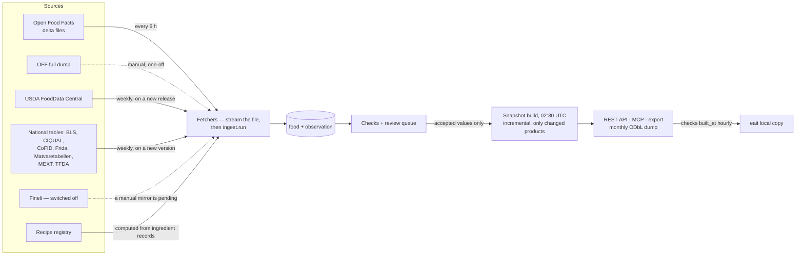

# fooddb

A food nutrition database that you host yourself. It merges USDA FoodData Central, seven national
food tables and Open Food Facts into one dataset. Every value keeps its source and its licence.
You query it through a REST API, an MCP server or a CLI.

[Why fooddb](docs/why-fooddb.md) compares it with Open Food Facts, OpenNutrition and the hosted
nutrition APIs.

## Where the data comes from



| Source | Country | Licence | What is fetched | How often | Contributes | Records, prod 15 Oct 2026 |
|---|---|---|---|---|---|---|
| Open Food Facts | worldwide | ODbL-1.0 | JSONL delta files at `static.openfoodfacts.org/data/delta/`; the ~13 GB dump `openfoodfacts-products.jsonl.gz` runs once, by hand | deltas every 6 h | barcoded products — the `off` layer | 3,028,974 |
| USDA FoodData Central | US | CC0-1.0 | JSON zips under `fdc.nal.usda.gov/fdc-datasets/` — Foundation, SR Legacy and Survey (FNDDS: foods as eaten, mixed dishes included) (Branded is off by default) | weekly; only a new release downloads | generic foods, dishes and branded products | 8,156 |
| BLS | Germany | CC-BY-4.0 | the workbook zip linked from `blsdb.de/download` | weekly; only a changed zip downloads | the German composition table | 7,140 |
| CIQUAL | France | etalab-2.0 | the Excel table linked from `ciqual.anses.fr` | weekly; only a new release downloads | the French composition table | 3,484 |
| CoFID | UK | OGL-UK-3.0 | the dataset workbook on the `gov.uk` publication page | weekly; only a new attachment downloads | the UK composition table | 2,885 |
| MEXT | Japan | mext-free-use | three Excel tables from `mext.go.jp` (8th edition, 2023 supplement) | weekly; only a new release downloads | the Japanese composition table — no English names, so eait does not use it yet | 2,538 |
| Matvaretabellen | Norway | NLOD-2.0 | `matvaretabellen.no/api/en/foods.json` — the whole table | weekly; only a changed file downloads | the Norwegian composition table | 2,121 |
| TFDA | Taiwan | OGDL-Taiwan-1.0 | the CSV zip of `data.gov.tw` dataset 8543 | weekly; only a new version downloads | the Taiwanese composition table — no English names, so eait does not use it yet | 2,116 |
| Frida | Denmark | CC-BY-4.0 | `Dataset.xlsx` of the figshare record | weekly; only a new version downloads | the Danish composition table | 1,381 |
| Fineli | Finland | CC-BY-4.0 | the open-data zip at `fineli.fi` | off — fineli.fi refuses automated downloads, so a manual mirror is pending | the Finnish composition table | — |
| Recipes | — | the ingredients' | computed from ingredient records, never typed in | rebuilt with each snapshot | dish values from their ingredients | 40 |
| Agent-written names | ru, es | AGPL-3.0 | nothing fetched — `data/names/mt/{ru,es}.tsv`, written by an AI agent and reviewed | with the code | Russian and Spanish names for core records, loaded as `food_name` `origin='mt'` — a table refetch does not touch them | 500 × 2 (pilot) |

The same worker writes the monthly ODbL dump of the OFF layer (1st of the month, 04:00 UTC) and
prunes the request log daily (03:15 UTC). [docs/architecture.md](docs/architecture.md) has every
part of this in detail — the fetchers, the checks, the queue, the snapshot and the jobs table.

## Install and look up a food

You need a Linux or macOS machine with git, make, Docker with Compose v2, and curl.

```bash
git clone https://github.com/eait-fit/fooddb.git && cd fooddb && make install
```

The install builds the stack and waits until the API answers. On the first start, the worker
downloads the sources, which takes 1 to 7 minutes. Then look up an apple pie with one request:

```bash
curl "http://127.0.0.1:8000/v1/foods?q=apple+pie&limit=1"
```

Or with one make command:

```bash
make search q="apple pie"
```

Both return the same data, shortened here:

```json
{"items": [{
  "id": 17335,
  "records": ["matvaretabellen:05.131"],
  "name": {"value": "Pie, apple", "source": "matvaretabellen", "licence": "NLOD-2.0", "record": "matvaretabellen:05.131"},
  "per_100": {
    "ENERC_KCAL": {"value": 214.0, "unit": "kcal", "basis": "100g", "source": "matvaretabellen", "licence": "NLOD-2.0"},
    "PROCNT": {"value": 2.6, "unit": "g", "basis": "100g", "source": "matvaretabellen", "licence": "NLOD-2.0"}
  }
}]}
```

Look up a packaged product with `GET /v1/products/{barcode}`. Say which country you are searching
for and the answer favours that country's tables: `?country=de` ranks BLS records first among
equal matches. To connect an AI agent, add the MCP
server: `claude mcp add --transport http fooddb http://127.0.0.1:8000/mcp`.

- [docs/deploy.md](docs/deploy.md): TLS, upgrades, backups and API keys
- [docs/usage.md](docs/usage.md): every endpoint, the response shape, MCP, the CLI and local sync

You can also use the hosted instance at [food-api.eait.fit](https://food-api.eait.fit). Get a key
in its [customer portal](https://food-api.eait.fit/portal).

## Review by an agent

A value that fails a check waits in the review queue — the queue `/admin/review` shows a person.
An agent can work it autonomously over the HTTP API with `fooddb-review`, one stdlib-only Python
file (`src/fooddb/reviewcli.py`) that runs anywhere `python3` does. It needs a key with the
`review` scope, read from the environment and never echoed:

```bash
export FOODDB__REVIEW__KEY=fdb_…                          # fooddb keys create --name agent --scope review
export FOODDB__REVIEW__URL=https://food-api.eait.fit      # the default; --url overrides

fooddb-review facets                            # how many records wait, per source and per check
fooddb-review queue --source recipe --limit 2   # two records of the recipe slice, as JSON
fooddb-review queue --source recipe --detail    # each record's values and why its checks failed
fooddb-review decide 42 43 --accept --by agent  # one JSON line per id; accept serves the value
                                                # from the next snapshot on, reject never serves it
```

`queue` filters with `--source` and `--check` and pages with `--limit`/`--offset`; `decide` keeps
going past a value that is no longer pending. A decision is recorded under `--by`, plus the key's
name when the two differ. `python3 src/fooddb/reviewcli.py --help` works without installing.

## Contribute

- [CONTRIBUTING.md](CONTRIBUTING.md): the local dev setup (`./dev`), tests and the PR process
- [docs/architecture.md](docs/architecture.md): the parts and the data flow, with diagrams
- [docs/design.md](docs/design.md): the pipeline, the data model and the sources
- [docs/decisions.md](docs/decisions.md): what is settled and what is still open
- [docs/data-licence.md](docs/data-licence.md): the licence of each source and the ODbL rules
- [Issues](https://github.com/eait-fit/fooddb/issues): bugs and planned work
- [SECURITY.md](SECURITY.md): report a vulnerability privately

The code is under [AGPL-3.0](LICENSE). The data keeps the licence of its source.
